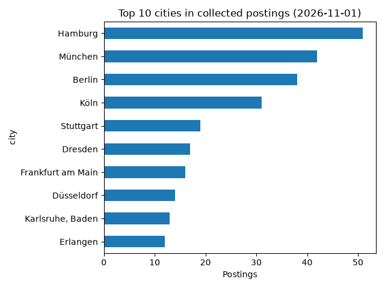
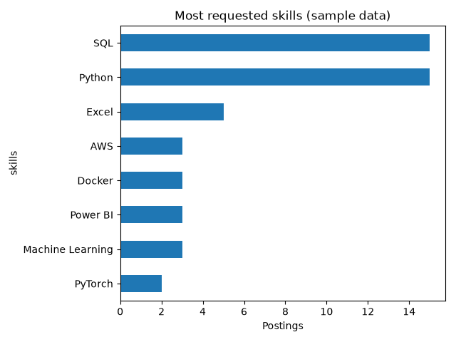

# Germany Job Market Analyser

Analysis of data and AI job openings in Germany: which roles, cities, and skills are in demand.

## Goal
Help data science students and graduates see where the opportunities are in the German job market.

## Tech stack
Python, pandas, matplotlib, Streamlit

## Results (sample data)

 

## How to run
1. Clone the repo
2. Create a virtual environment: python3 -m venv .venv
3. Activate it: source .venv/bin/activate
4. Install packages: pip install -r requirements.txt
5. Run the analysis: python src/analyse.py

## Project status
Work in progress. Currently uses sample data. Next steps: real job data, skill analysis, and a Streamlit dashboard.

## Author
Harshith Yarramreddy, M.Sc. Web and Data Science, University of Koblenz