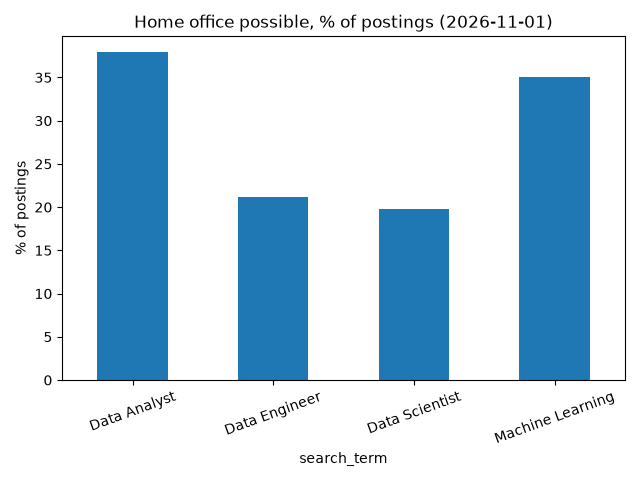

# Germany Job Market Analyser

Analysis of data and AI job postings in Germany: which cities and roles offer opportunities, and how common home office is.

## Goal
Help data science students and graduates see where the opportunities are in the German job market.
 Start the dashboard: streamlit run src/app.py
## Tech stack
Python, pandas, matplotlib, requests

## Results

Data source: public job search of the Bundesagentur für Arbeit (German Federal Employment Agency), collected with `src/collect.py`. Each chart is based on a sample of up to 200 postings per search term.

## How to run
1. Clone the repo
2. Create a virtual environment: python3 -m venv .venv
3. Activate it: source .venv/bin/activate
4. Install packages: pip install -r requirements.txt
5. Collect data: python src/collect.py
6. Run the analysis: python src/analyse.py
7. Start the dashboard: streamlit run src/app.py

## Project status
   Working prototype with real data and an interactive Streamlit dashboard. Next steps: skill extraction from job descriptions and deployment of the dashboard.

## Author
Harshith Yarramreddy, M.Sc. Web and Data Science, University of Koblenz